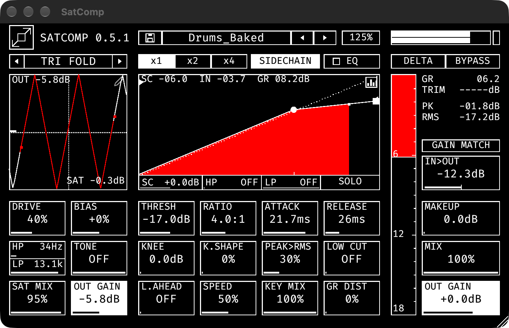

# SatComp

A waveshaping saturator with a compressor and a 2-stage 3-band EQ, in a black-and-white monospace UI. Made with bricking intentions.



VST3 and CLAP for macOS (Apple silicon and Intel) and Windows. Current version: **0.5.1**.

## Features
- **Saturator:** 15 shapers including a **Custom** one you draw yourself (pencil icon, up to 10 points), drive, bias, HP/LP split, tone, sat mix, output gain, 1x/2x/4x oversampling.
- **Sidechain:** external key from a second stereo input, with gain, HP and LP on the key and a SOLO to listen to it.
- **Compressor:** threshold, ratio, attack, release, knee and knee shape, peak/RMS detector, low cut, lookahead, feed-forward/feedback blend, GR distortion, makeup and mix.
- **EQ:** two stages (pre and post compressor), three bands each plus tilt, with a live spectrum.
- **Metering and tools:** output meter, gain-reduction meter, GAIN MATCH, DELTA monitor, loudness-matched BYPASS.
- **Presets:** save and load your own, step through them, six Drums factory presets included. A name wrapped in asterisks (`*NAME*`) means the preset has been modified.
- **20 colour schemes, each with a light mode:** click the icon for the next scheme, double-click it for light/dark, right-click for the list.
- Resizable window. Double-click any slider to reset it.

Click the title for an About page with the signal flow and the changelog.

## Install
Download the zip for your system from the [Releases](../../releases) page and copy the bundles:

| | macOS | Windows |
|---|---|---|
| VST3 | `~/Library/Audio/Plug-Ins/VST3/` | `C:\Program Files\Common Files\VST3\` |
| CLAP | `~/Library/Audio/Plug-Ins/CLAP/` | `C:\Program Files\Common Files\CLAP\` |

Then rescan plug-ins in your DAW.

**macOS:** the build is not notarized. If Gatekeeper blocks it, run `xattr -dr com.apple.quarantine ~/Library/Audio/Plug-Ins/VST3/satcomp.vst3` (and the same for the CLAP bundle).

User presets are saved to `~/Library/Application Support/SatComp/Presets` (macOS) or `%APPDATA%\SatComp\Presets` (Windows).

## Build
Requires [Rust](https://rustup.rs).

```bash
cd rust
cargo test
cargo xtask bundle satcomp --release            # this machine's architecture
cargo xtask bundle-universal satcomp --release  # macOS: arm64 + x86_64
```

Bundles land in `rust/target/bundled/`. GitHub Actions builds the macOS universal and Windows bundles on every push (see `.github/workflows/build.yml`) and attaches them to a release when a `v*` tag is pushed.

## Repository
- `rust/`: the production plug-in (`satcomp-dsp` engine, `satcomp-plugin` nih-plug shell and egui UI, factory presets in `satcomp-plugin/presets/`).
- `SatComp.jsfx`: the original REAPER JSFX prototype. Archival, frozen at v0.3.
- `docs/`: `FOUNDATION.md` (workflow and gotchas), `PARAMETERS.md` (parameter reference), `HANDOFF.md` (JSFX-era design decisions), `TEST_CHECKLIST.md`.

## Credits and license
GPL-3.0-or-later, see `LICENSE`. Built with [nih-plug](https://github.com/robbert-vdh/nih-plug) and [egui](https://github.com/emilk/egui). Typeface: [Fira Code](https://github.com/tonsky/FiraCode) (SIL OFL 1.1, bundled in `Fira_Code_v6.2/`).
