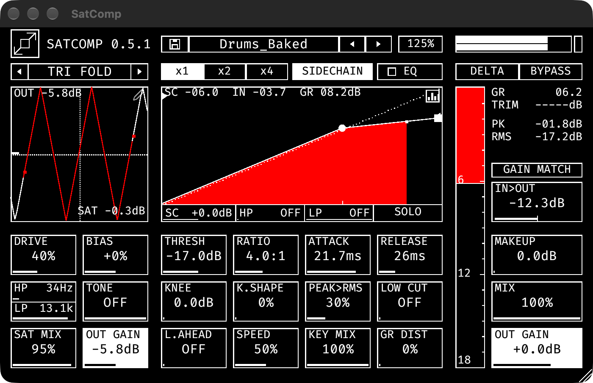

# SatComp 0.5.2

A waveshaping saturator with a compressor and a 2-stage 3-band EQ. Give the compressor more spice to squash. Made with bricking intentions.



## 1. The idea

SatComp is a single strip: a saturator that feeds a compressor, an EQ that can sit before or after it, and a true-peak limiter at the end.

```
IN > [pre EQ] > SAT > COMP > MIX > [post EQ] > OUT GAIN > LIM > OUT
```

The saturator comes first on purpose: driving the shaper changes what the compressor hears, so the harder you saturate, the more there is to squash.

## 2. Layout

| Area | What it does |
|---|---|
| Header | logo (themes), preset bar, window scale, oversampling, SIDECHAIN, EQ page, DELTA, BYPASS |
| Saturator (left) | shaper, DRIVE, BIAS, ASYM, HP, LP, TONE, SAT MIX, SAT GAIN and the transfer plot |
| Compressor plot (middle) | transfer curve with the live operating point, the threshold dot and the ratio square |
| Compressor cells | THRESH, RATIO, ATTACK, RELEASE, KNEE, K.SHAPE, PEAK>RMS, LOW CUT, L.AHEAD, SPEED, FF>FB, GR DIST |
| Output column | LIM / TRIM / PK / RMS readouts, GAIN MATCH, IN>OUT, MAKEUP, MIX, OUT GAIN |
| Meters | post-saturator level meter, gain reduction meter, output meter |

## 3. Saturator

| Control | What it does |
|---|---|
| Shaper | 15 waveshapers: Tube, Soft, Rational, Atan, Hard, Tri Fold, Sine Fold, Crossover, Cheby, Wrap, Rectify, Bitcrush, Asym Fold, Diode and **Custom** |
| DRIVE | how hard the signal is pushed into the shaper |
| BIAS | shifts the signal off-centre before the shaper: more even harmonics |
| ASYM | how much of the shaper's even-order part is kept. Lowering it stops lopsided curves from dragging DC and sub-bass pulses into the signal. Stored per shaper. |
| HP / LP | decide which part of the signal is saturated; the rest passes clean |
| TONE | low-pass on the shaped signal only |
| SAT MIX | blend between clean and saturated |
| SAT GAIN | level after the saturator, which is also the compressor's input level. Click the **SAT** readout in the plot corner to auto-match it. |
| x1 / x2 / x4 | oversampling of the saturator (less aliasing, more latency) |

**Custom curve.** Click the pencil icon in the plot corner to draw your own curve (up to 10 points). The symmetry tool draws one half and mirrors the other.

## 4. Compressor

| Control | What it does |
|---|---|
| THRESH / RATIO | where compression starts and how much. You can also drag the dot (threshold) and the square (ratio) in the plot. |
| ATTACK / RELEASE | how fast the gain reacts |
| KNEE / K.SHAPE | width and curve of the transition around the threshold |
| PEAK>RMS | detector type: 0 % peak, 100 % RMS |
| LOW CUT | high-pass in the detector only, so kicks and bass stop driving the reduction. The audio is untouched. |
| L.AHEAD | lookahead: the detector sees the signal before the gain is applied, so the compressor is already down when a transient arrives |
| SPEED | scales attack and release together |
| FF>FB | detector topology: 0 % feed-forward, 100 % feedback |
| GR DIST | soft saturation after the gain reduction, growing with how hard the compressor works |

### Sidechain

**SIDECHAIN** keys the compressor from the second stereo input, with key gain, HP and LP and a **SOLO** to listen to the key. **KEY MIX** takes the place of FF>FB and blends the key with the signal's own level. Routing belongs to the track, so the switch is saved with the project but not in presets.

## 5. EQ

The **EQ** button opens two EQ stages, one before and one after the compressor. Each has three bands plus a tilt, with a live spectrum. Use the pre stage to change what the compressor reacts to, the post stage to refine the tone.

## 6. Output

| Control | What it does |
|---|---|
| MAKEUP | gain after the compressor |
| MIX | parallel blend of the processed signal with the dry input |
| OUT GAIN | final level |
| LIM | true-peak brickwall output limiter at -0.2 dBTP, on by default. Its reduction is the LIM readout. |
| GAIN MATCH | measures the loudness change for 3 seconds and stores a trim so processed and dry levels match |
| IN>OUT | net loudness change across the plug-in |
| DELTA | listen to what the compressor removes |
| BYPASS | plain bypass at the plug-in's latency: your dry signal at its own level |

The **gain reduction meter** on the right shows the compressor's work. **Click** it to cycle its range. The number at the top is the reduction. The thin meter to its left is the level after the saturator; it turns accent for a second when the saturator output passes 0 dBFS. **Click** the output meter's top block to reset the clip lamp and the peak readout.

**Waveform scope.** Click the icon in the corner of the compressor plot for a half or full wave view of the output with the gain reduction stacked on top (a transient meter). Drag it to change the time window and the ceiling.

## 7. Recipes

**Thick drums.** Pick Tube or Diode, drive to 30-40 %, set ASYM to around 50 %, then compress with a fast attack and a medium release. Let the compressor squash what the saturator added.

**Grit that follows the level.** Raise GR DIST. The distortion grows with how hard the compressor works and vanishes when it is not reducing.

**Ducking.** Turn SIDECHAIN on and key from a kick. Raise LOW CUT to keep bass from fighting the key.

## 8. Good to know

- **Latency** is constant (about 2.2 ms at 48 kHz) and reported to the host, whether the limiter is on or off.
- **Presets:** six Drums presets ship with the plug-in; yours are saved to `SatComp/Presets` in your application-support folder. A name in asterisks means the preset has been modified.
- **Themes:** click the logo for the next scheme, double-click it for dark/light, right-click for the list. The title opens About, Preferences and the changelog.
- **About page:** click the title. **OPEN MANUAL (PDF)** opens this manual. The signal flow is live, and its PRE EQ, POST EQ and LIM blocks are switches you can click to bypass them.
- Double-click any slider to reset it.

## Support and links

- Source code, issues and releases: [github.com/thomchantra/SatComp](https://github.com/thomchantra/SatComp)
- Support the project: [ko-fi.com/thomchantra](https://ko-fi.com/thomchantra)

Found a bug or have an idea? Open an issue on GitHub. Thank you for using SatComp.

## Notes to check (delete before the PDF)

- Order of the pre and post EQ relative to the saturator (diagram assumes sat > comp, pre EQ first in the chain).
- Recipe values are suggestions.
