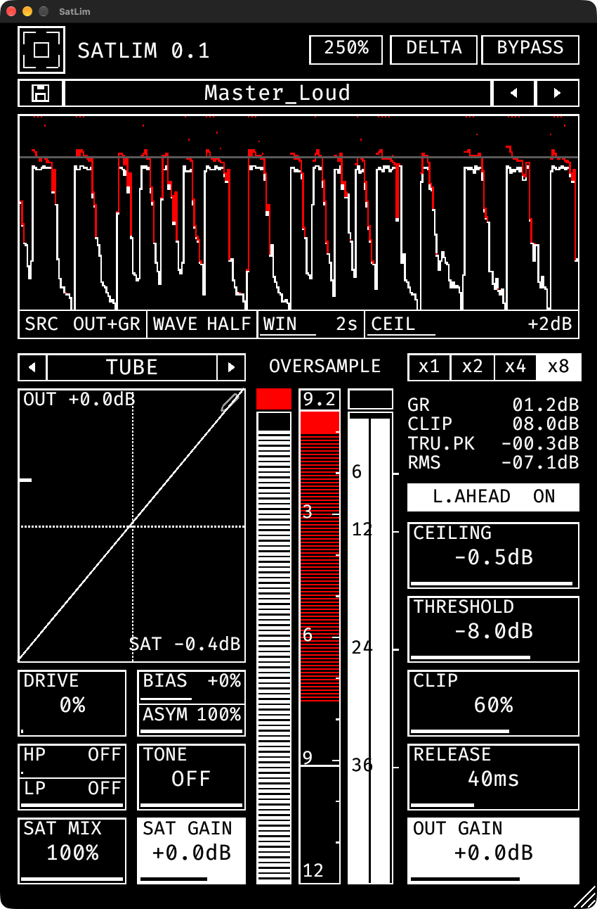

# SatLim 0.1.0

A 2-stage clipper and limiter with a waveshaping saturator. When you need to nuke it from orbit.



## 1. The idea

SatLim chews the signal in three steps: a saturator, a hard clipper that bricks the peaks, and a true-peak limiter that catches what the clipper leaves behind.

```
IN > SAT (x1-x8) > lift to the ceiling > CLIP > LIMITER > OUT GAIN > OUT
```

- **THRESHOLD** is the input level that lands on the ceiling. The signal is lifted by `CEILING - THRESHOLD` dB, so lowering the threshold pushes harder into the clipper and limiter.
- **CLIP** clamps the peaks at the ceiling (oversampled) before the limiter sees them. The more clip, the less the limiter has to do, and the more the transients get bricked.
- **LIMITER** catches the remaining inter-sample peaks. With lookahead on it is a true-peak brickwall.
- **OUT GAIN** is after the limiter on purpose. The ceiling is what the limiter holds; the output gain is free, so you can pull the level back for converters that see inter-sample peaks.

## 2. Layout

| Area | What it does |
|---|---|
| Header | logo (themes), preset bar, window scale, DELTA, BYPASS |
| Transient scope | the output with what the limiter and the clipper removed, stacked |
| Scope controls | SRC, WAVE, WIN and CEIL settings under the scope |
| Saturator (left) | shaper, DRIVE, BIAS, ASYM, HP, LP, TONE, SAT MIX, SAT GAIN and the transfer plot |
| Meters (middle) | post-saturator level, gain reduction, output level |
| Right column | OVERSAMPLE, readouts, L.AHEAD, CEILING, THRESHOLD, CLIP, RELEASE, OUT GAIN |

## 3. Limiter section

| Control | What it does |
|---|---|
| CEILING | the level the limiter holds |
| THRESHOLD | input level that lands on the ceiling; lower is harder |
| CLIP | 0-100 %. 0 = off. Otherwise a hard clamp at the ceiling, driven up to +6 dB into it. |
| RELEASE | 15-80 ms. A shorter release gives a denser, punchier result and more distortion artifacts; a longer one is smoother with less distortion. |
| L.AHEAD | on: 1.5 ms lookahead with true-peak detection, a brickwall. Off: zero limiter latency, but the gain follows sample peaks, so inter-sample overs can pass. |
| OUT GAIN | final level, after the limiter |
| x1 / x2 / x4 / x8 | oversampling of the saturator and the clipper (more oversampling, less aliasing, more latency) |

**Balance THRESHOLD and CLIP.** Use THRESHOLD to set how hard the signal hits the ceiling and CLIP to choose how much of that is bricked by the clipper instead of squeezed by the limiter. More clip sounds harder and more distorted; more limiting sounds denser and flatter.

## 4. Saturator

| Control | What it does |
|---|---|
| Shaper | 15 waveshapers, from Tube for warm saturation through Tri Fold for destruction to **Custom** |
| DRIVE, BIAS, ASYM, HP, LP, TONE, SAT MIX | the same as in SatComp: push, offset, even-order amount, band split, tone, wet/dry |
| SAT GAIN | level after the saturator. Click the **SAT** readout to auto-match it. |

**Custom curve.** Click the pencil icon to draw your own transfer curve (up to 10 points), with a symmetry tool for odd curves.

## 5. Scope and meters

The **transient scope** shows the output waveform (UI colour) with two things stacked on top: what the limiter removed (solid accent) and what the clipper removed (hatched accent), up to the peak before clipping. Drag the scope to change its window; **CEIL** sets the ceiling of the view (+10 to -14 dB) so heavy clipping above 0 dBFS stays visible.

| Readout | Meaning |
|---|---|
| GR | limiter gain reduction |
| CLIP | clipper reduction |
| TRU.PK | true peak of the output (8x), whether lookahead is on or off. It turns accent only when it clips. |
| RMS | output level |

The **gain reduction meter** splits the same way: the limiter's part solid, the clipper's part hatched under it. **Click** it to cycle its range. The output meter's top block holds the clip lamp; **click** it to reset it and the peak readout.

## 6. Output and tools

| Control | What it does |
|---|---|
| DELTA | listen to what the clipper and limiter removed |
| BYPASS | plain bypass: your input at the plug-in's latency, at its own level |

## 7. Recipes

**Master-bus loudness.** Pick Tube with low drive, a ceiling at -1 dB, THRESHOLD around -4 to -6 dB and a moderate CLIP. Use a release around 40 ms. Pull OUT GAIN down 0.5 dB if you need headroom for the converter.

**Crunchy drums.** Diode with 30 % drive, x4, lookahead off, a short release and a firmer CLIP. Watch the scope: the hatched part is the clipper doing the work.

**Brickwall safety.** Keep CLIP at 0, put the ceiling where you want it and use a low threshold only if you want loudness as well as protection.

## 8. Good to know

- **Latency** is the saturator oversampler plus the clipper oversampler plus the limiter lookahead. It is reported to the host and changes with the x1-x8 setting and L.AHEAD.
- **Presets:** six factory presets ship with the plug-in; yours are saved to `SatLim/Presets` in your application-support folder.
- **Themes:** click the logo for the next scheme, double-click it for dark/light, right-click for the list. **Preferences** has **SCOPE FILL**: solid bars or an outline.
- **About page:** click the title for the signal flow, **OPEN MANUAL (PDF)**, Preferences and the changelog.
- Double-click any slider to reset it.

## Support and links

- Source code, issues and releases: [github.com/thomchantra/SatComp](https://github.com/thomchantra/SatComp)
- Support the project: [ko-fi.com/thomchantra](https://ko-fi.com/thomchantra)

Found a bug or have an idea? Open an issue on GitHub. Thank you for using SatLim.

## Notes to check (delete before the PDF)

- Header cells: DELTA and BYPASS positions; the window-scale cell.
- Scope SRC and WAVE option names.
- Recipe values are suggestions (Master_Loud and Drums_Crunch presets use similar ones).
