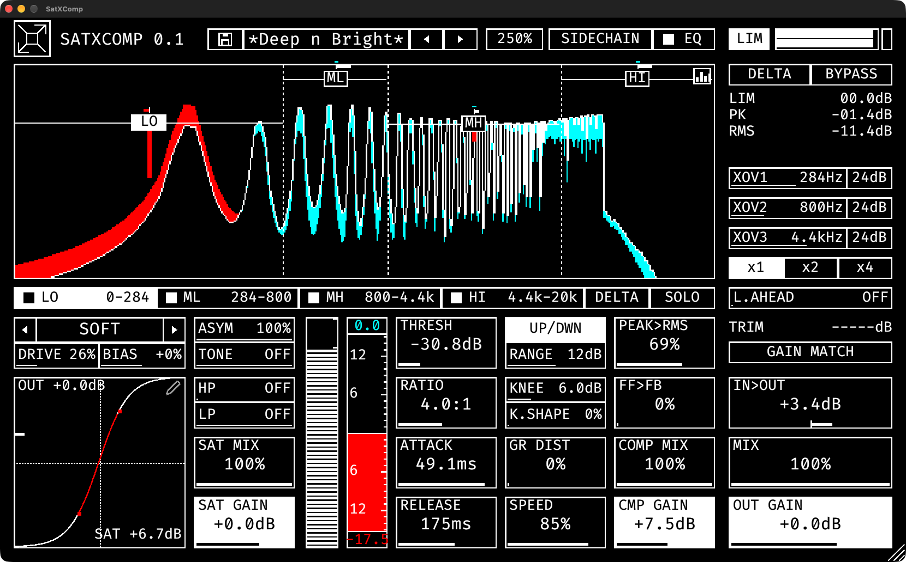

# SatXComp 0.1.0

A 4-band compressor with a waveshaping saturator on every band and a 5-band EQ. Split the signal, drive each band to taste, then squash it. For surgical baking.



## 1. The idea

The signal is split into four bands (LO, ML, MH, HI) by three crossovers. Every band has its own **saturator** and **compressor**, and the bands sum back together before the EQ, the output stage and a true-peak limiter.

```
IN > [4-band split] > per band: SAT > COMP > mix / gain > [sum] > 5-band EQ > MIX > OUT GAIN > LIM > OUT
```

The saturator only adds harmonics inside its own band, so driving the lows hard does not smear the highs. The compressor can reduce gain above the threshold, lift gain below it, or both.

## 2. Layout

| Area | What it does |
|---|---|
| Header | logo (themes), preset bar, window scale, SIDECHAIN, EQ page switch, LIM meter |
| Spectrum viewport | live spectrum of the output over the dry signal, crossover lines, one handle per band |
| Band tabs | LO / ML / MH / HI: select a band, switch it on or off, DELTA and SOLO for the selected band |
| Saturator (left) | shaper, DRIVE, BIAS, ASYM, TONE, HP, LP, SAT MIX, SAT GAIN and the transfer plot |
| Meters (middle) | post-saturator level meter of the selected band and its gain meter |
| Compressor (centre) | THRESH, RATIO, ATTACK, RELEASE, mode switch with RANGE, KNEE, K.SHAPE, PEAK>RMS, FF>FB, GR DIST, SPEED, COMP MIX, CMP GAIN |
| Right column | LIM / PK / RMS readouts, XOV1-3, oversampling, L.AHEAD, TRIM, GAIN MATCH, IN>OUT, MIX, OUT GAIN |

## 3. The spectrum viewport

The viewport shows the output spectrum drawn over the dry input.

- **Accent colour:** the compressor took gain away here (output below dry).
- **Inverted accent:** gain was added here (output above dry), from upward compression or a boosting saturator.

On a neutral grey theme (such as Ashen) the added gain is white, or black on a light scheme.

**Crossovers.** Drag a dotted line to move that crossover, or use the XOV sliders. Each crossover has its own slope button: 12, 24, 48 or 96 dB per octave. Steeper slopes isolate the bands better; gentler ones sound smoother. The bands sum flat at every setting, and changing a slope crossfades without clicks.

**Band handles.** Each band has a handle sitting at its threshold:

- **Drag** it up or down to set the threshold. **Click** it to select the band. **Double-click** resets the threshold.
- The **bar below** the handle is gain reduction (accent colour), 2 px per dB.
- The **bar above** it is gain increase from upward compression, in the inverted accent colour.
- The small **horizontal bar on top** shows the in/out level difference of the band: right = louder, left = quieter.

## 4. Saturator (per band)

Select a band with its tab; the saturator and compressor cells show that band.

| Control | What it does |
|---|---|
| Shaper | 15 waveshapers: Tube, Soft, Rational, Atan, Hard, Tri Fold, Sine Fold, Crossover, Cheby, Wrap, Rectify, Bitcrush, Asym Fold, Diode and **Custom**. Click the name or right-click for the list. |
| DRIVE | how hard the band is pushed into the shaper |
| BIAS | shifts the signal off-centre before the shaper: more even harmonics |
| ASYM | how much of the shaper's even-order part is kept (100 % = all). Lowering it keeps lopsided curves from dragging DC and sub-bass pulses into the signal. Stored per shaper. |
| TONE | low-pass on the shaped signal only, to tame the harmonics |
| HP / LP | high-pass and low-pass that decide which part of the band is saturated; the rest passes clean |
| SAT MIX | blend between clean and saturated band |
| SAT GAIN | level after the saturator. Click the **SAT** readout in the plot corner to auto-match: it measures for 3 seconds and sets the SAT GAIN that cancels the loudness change. Click again to cancel. |

**Custom curve.** Click the pencil icon in the plot corner to draw your own transfer curve (up to 10 points). The symmetry tool draws one half and mirrors the other, which keeps the curve odd and DC-free. Each band keeps its own custom curve.

## 5. Compressor (per band)

| Control | What it does |
|---|---|
| THRESH | level where compression starts (also the band handle) |
| RATIO | amount of compression above (and, upward, below) the threshold |
| ATTACK / RELEASE | how fast the gain reacts. Slower suits low bands, faster suits high bands. |
| KNEE / K.SHAPE | width and curve of the transition around the threshold |
| PEAK>RMS | detector type: 0 % peak, 100 % RMS |
| FF>FB | detector topology: 0 % feed-forward, 100 % feedback (replaced by KEY MIX with the sidechain on) |
| GR DIST | soft saturation after the gain reduction, growing with how hard the compressor works |
| SPEED | scales attack and release together: lower is faster, higher is slower |
| COMP MIX | parallel blend of the compressed and uncompressed band |
| CMP GAIN | makeup gain of the band |

### Compressor mode

The switch above RANGE steps through three modes (click or wheel):

- **DWNWARD:** the ordinary compressor: reduces gain above the threshold.
- **UPWARD:** lifts what is below the threshold toward it by the ratio, never more than **RANGE** dB. Quiet detail comes up; loud parts are untouched.
- **UP/DWN:** both from the same threshold: lifts below, reduces above.

RANGE is dim in DWNWARD because it only limits the lift.

### Gain meter

The vertical meter next to the compressor cells shows the selected band. In DWNWARD it shows reduction. In UPWARD and UP/DWN it is centre-tapped: lift grows upward in the inverted accent, reduction grows downward in the accent. **Click** it to cycle its range (3, 6, 12, 18 dB). The number window at the top shows the lift; in UP/DWN a second window at the bottom shows the reduction.

## 6. Sidechain

Switch **SIDECHAIN** on to key the compressors from the plug-in's second stereo input (route a track's send to input 3/4 in your host). The key is conditioned (SC gain, HP, LP), split across the four bands and drives each band's compressor, so it ducks like a dynamic EQ: only the band the key excites gets reduced.

- **KEY MIX** (replaces FF>FB while sidechain is on) blends the key with the band's own level.
- **SOLO** lets you listen to the key as the detector hears it.
- The SIDECHAIN button is white when the host supplies a bus, and in the accent colour when it is on without one.

Sidechain routing belongs to the track, so it is saved with the project but not in presets.

## 7. EQ page

The **EQ** button swaps the viewport for a 5-band post-compressor EQ with a live spectrum. Each band can be a bell, shelf, notch, bandpass or allpass; there is also a tilt control. Use the EQ's own mix to blend the filtered signal with the dry one, which is how the notch, bandpass and allpass types become useful for sculpting. The EQ page shows its own IN>OUT difference (I>O).

## 8. Output section

| Control | What it does |
|---|---|
| MIX | blend of the processed signal with the dry input |
| OUT GAIN | final level |
| LIM | the output limiter: a true-peak brickwall at -0.2 dBTP, on by default. Its reduction shows in the LIM readout. |
| x1 / x2 / x4 | oversampling for the saturators |
| L.AHEAD | lookahead for the compressors |
| GAIN MATCH | measures the loudness change over 3 seconds and sets a trim so bypassed and processed levels match |
| IN>OUT | net loudness change across the plug-in |
| DELTA | listen to what the selected band (or the whole chain) removes |
| BYPASS | plain bypass at the plug-in's latency: your dry signal at its own level |

## 9. Recipes

**Heavy low end without a muddy top.** Set XOV1 near 150 Hz at 24 dB. Drive LO with Tube, set ASYM to around 50 % and a slow attack and release. Leave the other bands clean.

**Dynamic EQ ducking.** Turn SIDECHAIN on, route the key (for example a kick) to the second input and solo the band you want to duck. Use a fast attack and release, then trim with KEY MIX.

**Bring up the room.** Set a band to UPWARD with a low threshold, RANGE around 6 dB and a gentle ratio. Quiet tails come up; peaks stay put. Watch the bar above the band handle.

**Glue the whole mix.** Use 12 dB crossovers, a low ratio on every band and a slow release, then raise COMP MIX to taste.

## 10. Good to know

- **Latency** is constant and reported to the host. Switching the limiter or bands never changes it.
- **Presets:** four factory presets ship with the plug-in. Your own are saved to `SatXComp/Presets` in your application-support folder. A name wrapped in asterisks means the preset has been modified. Presets keep the bands, curves and EQ, but not the sidechain routing or bypass.
- **Themes:** click the logo for the next theme, double-click it for dark/light, right-click for the list. The title opens About, Preferences and the changelog.
- **About page:** click the title. Besides the changelog and **OPEN MANUAL (PDF)**, the signal flow is live: dots show the level, bands light up while they work, and each band block, EQ, LIM and the SIDECHAIN box are switches you can click to bypass them.
- **Shortcuts:** double-click any slider to reset it.

## Support and links

- Source code, issues and releases: [github.com/thomchantra/SatComp](https://github.com/thomchantra/SatComp)
- Support the project: [ko-fi.com/thomchantra](https://ko-fi.com/thomchantra)

Found a bug or have an idea? Open an issue on GitHub. Thank you for using SatXComp.

## Notes to check (delete before the PDF)

- Window scale: the cell next to the preset bar is the scale; confirm it is click-to-cycle.
- EQ filter types and the EQ's MIX / tilt wording.
- "Click it to cycle its range (3, 6, 12, 18 dB)" for the gain meter.
- The routing hint "input 3/4" is the usual host convention; confirm for REAPER.
- Recipe parameter values are suggestions, not tested presets.
